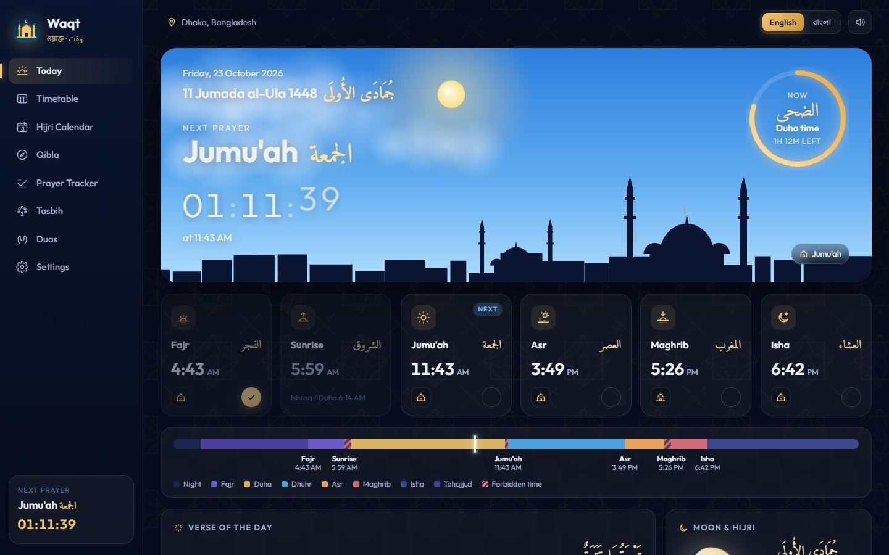
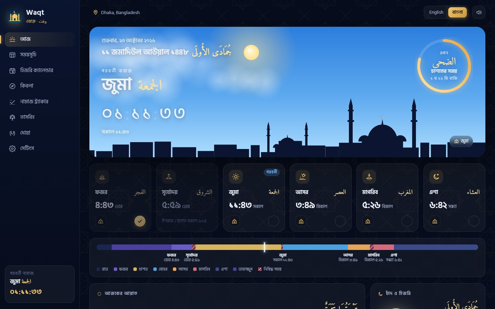
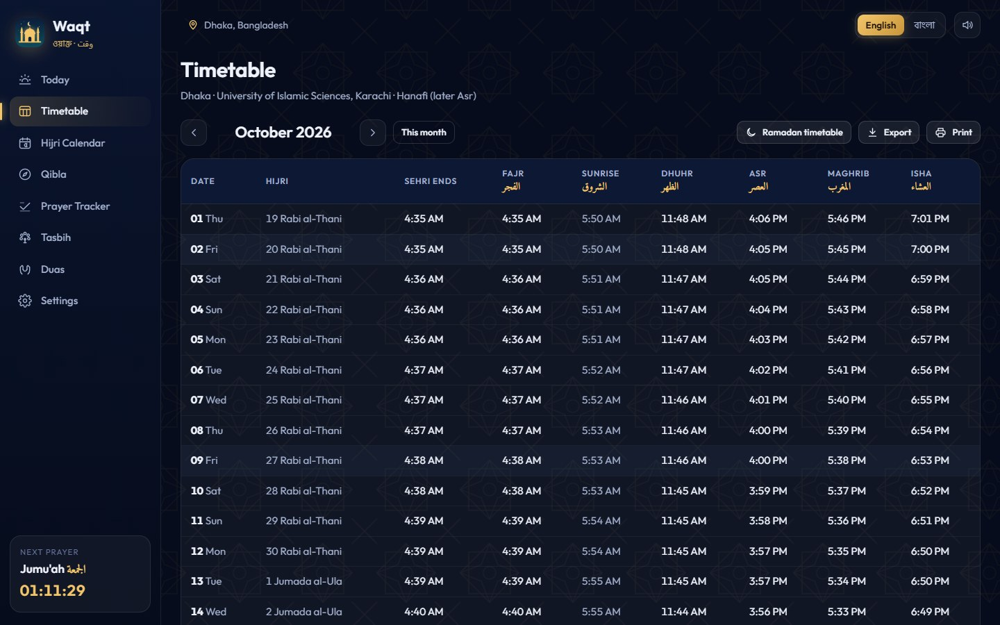
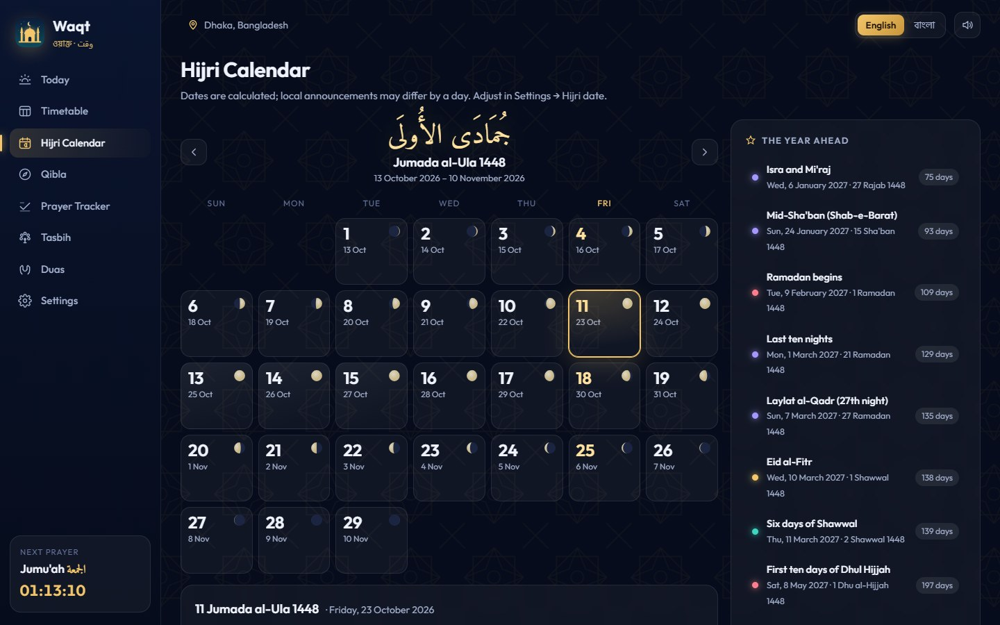
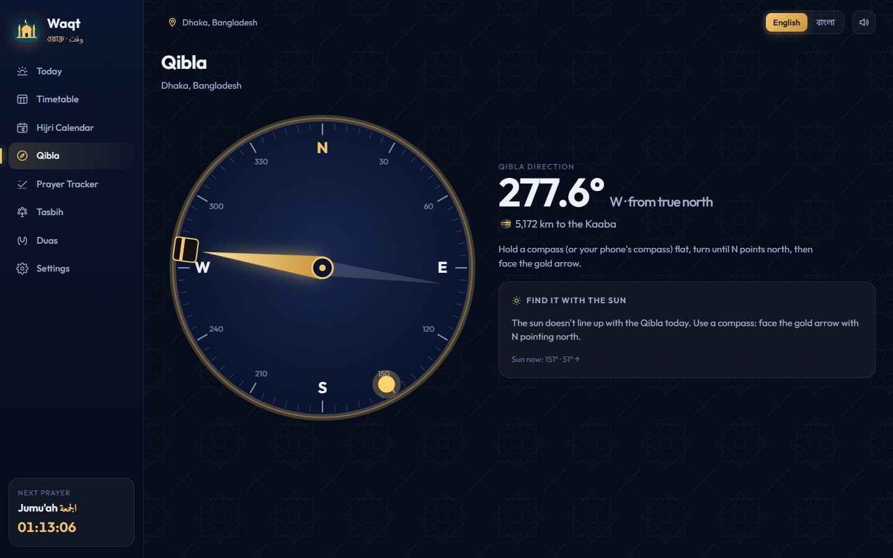
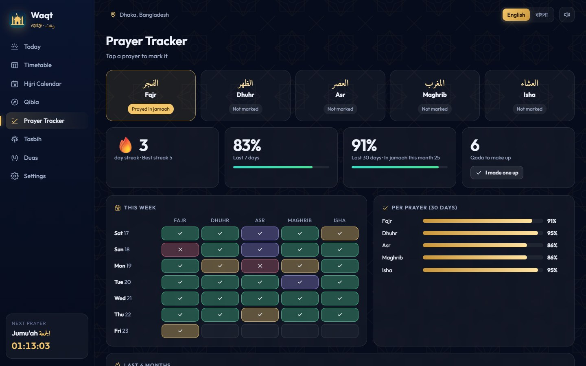
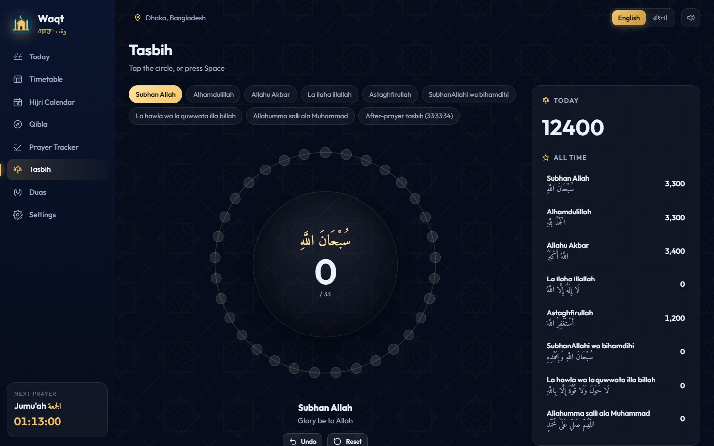
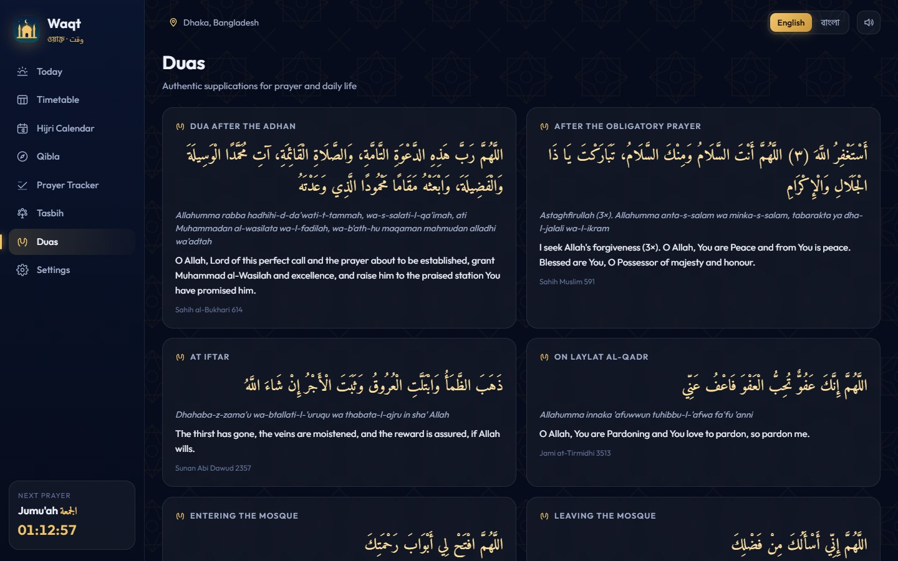
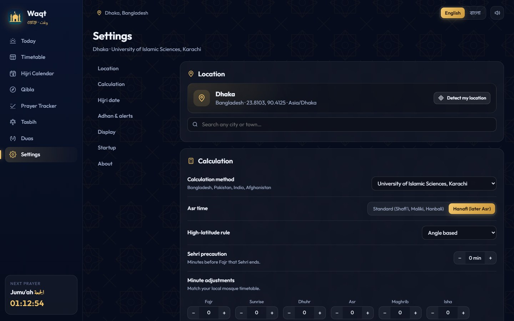
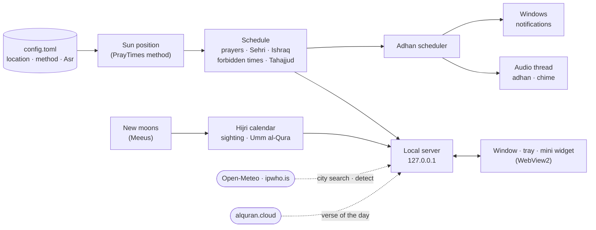

<div align="center">


# Waqt · ওয়াক্ত · وقت

**Prayer times, adhan, the Hijri calendar and Qibla for your desktop, in English and বাংলা.**

Waqt calculates the five daily prayers for your city, plays a full adhan
at each one (even when the window is closed), and keeps the Islamic
calendar, a prayer tracker and a tasbih close at hand.




</div>

---

## Why Waqt?

Most prayer-time apps live on the phone, and desktop ones are often ad-filled
web pages that stop working without the internet. Waqt is a small native app
that sits in the tray and simply works:

- 🕌 **A real adhan, on time.** Full recordings from Makkah, Madinah, Al-Aqsa
  and more, with a dedicated Fajr adhan. They sound from the tray even when
  the window is closed.
- 📴 **Prayer times without the internet.** Everything is calculated on your
  PC from the sun's position, using the same method as Aladhan and
  IslamicFinder. The network is only used for city search and the verse of
  the day.
- 🌙 **A Hijri calendar that matches your country.** Months start by local
  moon sighting (as in Bangladesh, Pakistan and India) or by Saudi Umm
  al-Qura, with a one-click offset when the official announcement differs.
- 🇧🇩 **Made for Bangla speakers.** The whole interface is available in
  বাংলা, with Bangla digits and Bangla prayer names, and the defaults are set
  for Bangladesh (Karachi method, Hanafi Asr).

## Features

<table>
<tr>
<td width="50%" valign="top">

### 🕰️ Prayer times
- Fajr, Sunrise, Dhuhr, Asr, Maghrib and Isha, plus **Jumu'ah** on Fridays
- **15 calculation methods**: Karachi, MWL, ISNA, Egypt, Umm al-Qura, Dubai,
  Singapore, Diyanet, Tehran, …
- **Hanafi or standard Asr**, and high-latitude rules
- Per-prayer **minute adjustments** to match your mosque
- Related times: **Sehri ends**, **Ishraq / Duha**, **forbidden times** and
  the **last third of the night** (Tahajjud)
- A **day timeline** and a live sky that follows the sun

</td>
<td width="50%" valign="top">

### 🔊 Adhan and alerts
- **9 adhan recordings**, including Makkah and Madinah **Fajr adhans**
  (with *as-salatu khayrun min an-nawm*)
- For each prayer, choose **Adhan**, **Chime**, **Notification only** or
  **Off**
- **Import your own** adhan (MP3, WAV, OGG, FLAC)
- Reminders **before** a prayer, a **sunrise warning** that Fajr is ending,
  a **Sehri alarm** in Ramadan, and a **Jumu'ah and Al-Kahf** reminder
- A full-screen **adhan moment** with the dua after the adhan
- **Silence adhan for today** from the tray

</td>
</tr>
<tr>
<td valign="top">

### 🌙 Hijri calendar
- A month view with **moon phases** and both Hijri and Gregorian dates
- **The year ahead**: Ramadan, Laylat al-Qadr, both Eids, Arafah, Ashura,
  Shab-e-Barat, Mi'raj, … with a countdown in days
- Sunnah fasts: the **white days**, and Mondays and Thursdays
- A **Ramadan timetable** button that jumps to the month of fasting, with
  Sehri times
- **Monthly timetable** with **CSV export** (opens in Excel) and **Print**

</td>
<td valign="top">

### 🧭 Qibla, tracker, tasbih and duas
- **Qibla compass** with the bearing and the distance to the Kaaba, plus the
  times today when the **sun points to the Qibla**
- **Prayer tracker**: on time, in jamaah, late or missed, with streaks, 7- and
  30-day scores, and a **qada** counter
- **Tasbih** with 8 dhikr, the after-prayer **33·33·34** sequence and lifetime
  totals (click, or press Space)
- **Duas** for the adhan, after prayer, iftar, Laylat al-Qadr and the mosque,
  with transliteration and sources

</td>
</tr>
</table>

**On the desktop:** a tray icon shows the next prayer, the window can close
to the tray so the adhan keeps working, there's an always-on-top **mini
widget**, Windows notifications appear under Waqt's own name and icon, and
the app can start with Windows.

<p align="center"><br><sub><b>Mini widget:</b> the next prayer and a countdown, always on top</sub></p>

## Screenshots

<table>
<tr>
<td width="50%"><p align="center"><b>বাংলা:</b> the whole app in Bangla, with Bangla digits</p></td>
<td width="50%"><p align="center"><b>Adhan moment:</b> full screen, with the dua after the adhan</p></td>
</tr>
<tr>
<td><p align="center"><b>Timetable:</b> the whole month, Sehri included, with export and print</p></td>
<td><p align="center"><b>Hijri Calendar:</b> moon phases and the year's Islamic dates</p></td>
</tr>
<tr>
<td><p align="center"><b>Qibla:</b> bearing, distance and finding it with the sun</p></td>
<td><p align="center"><b>Prayer Tracker:</b> streaks, scores and qada</p></td>
</tr>
<tr>
<td><p align="center"><b>Tasbih:</b> 8 dhikr, the 33·33·34 sequence, lifetime totals</p></td>
<td><p align="center"><b>Duas:</b> Arabic, transliteration, meaning and source</p></td>
</tr>
<tr>
<td><p align="center"><b>First run:</b> language, location, method and adhan in five steps</p></td>
<td><p align="center"><b>Settings:</b> location, calculation, Hijri date, adhan, display, startup</p></td>
</tr>
</table>

## Getting started

### Requirements

| | |
|---|---|
| **OS** | Windows 10 or 11 (the window uses Microsoft Edge WebView2, which Windows 11 already has) |
| **Sound** | Any speaker or headphones, for the adhan |
| **To build** | [Rust](https://rustup.rs) (stable) and the MSVC Build Tools (the C++ workload) |

### Build and run

```powershell
git clone https://github.com/coderasraf/waqt.git
cd waqt
cargo build --release
.\target\release\waqt.exe
```

The build produces two programs:

| File | What it is |
|---|---|
| `waqt.exe` | the desktop app, with the tray icon and the adhan scheduler |
| `waqt-cli.exe` | the command-line tool |

The command-line tool isn't called `waqt.exe` because Windows file names
ignore case, so it would overwrite an installed `Waqt.exe`.

> [!NOTE]
> If the build fails with *"An Application Control policy has blocked this
> file (os error 4551)"*, Windows **Smart App Control** is blocking the build
> scripts that cargo compiles. Build with Smart App Control turned off, or
> under WSL.

### First run

A short setup opens the first time:

1. **Language:** English or বাংলা.
2. **Location:** click **Detect my location**, or search for any city or town.
3. **Calculation:** Waqt suggests the method and Asr school your country
   uses. For example, Bangladesh gets *Karachi · Hanafi*, Saudi Arabia gets
   *Umm al-Qura*, and the US gets *ISNA*.
4. **Adhan:** listen to the recordings and pick one, or choose a chime or
   notification instead.
5. **All set.** Waqt stays in the tray and starts with Windows. You can change
   both in **Settings → Startup** (*Start with Windows*, *Close button keeps
   Waqt in the tray*).

If your mosque's timetable differs by a minute or two, use **Settings →
Calculation → Minute adjustments**. If the Hijri date is a day off from your
country's announcement, use **Settings → Hijri date**.

| What | Where |
|---|---|
| Settings | `%APPDATA%\Waqt\config.toml` |
| Tracker, qada and tasbih counts | `%APPDATA%\Waqt\state.json` |
| Your imported adhans | `%APPDATA%\Waqt\sounds\` |
| Verse-of-the-day cache, window profile | `%APPDATA%\Waqt\cache\`, `webview\` |

## How the times are calculated



- **Prayer times from the sun.** Waqt uses the PrayTimes.org method that
  Aladhan, IslamicFinder and most apps use: twilight angles per calculation
  method, the Hanafi or standard shadow factor for Asr, and high-latitude
  rules. It needs no network and no API.
- **Hijri months from the real new moon.** New moons are computed with Meeus'
  algorithm. A month begins when the crescent is old enough to be seen at
  sunset where you live (*local sighting*), or by Saudi Arabia's *Umm al-Qura*
  rule, or by the fixed arithmetic calendar. You can also move the Hijri date
  forward at Maghrib, when the Islamic day begins.
- **An adhan that doesn't depend on the window.** Audio plays on its own
  thread, so the adhan sounds even when Waqt is in the tray. Each recording's
  loudness is measured once and matched, and the volume can fade in. After
  the computer wakes from sleep, an adhan that is more than two minutes late
  is skipped rather than played.
- **Local and private.** The server listens only on `127.0.0.1`. Your tracker
  and tasbih counts stay in one JSON file on your PC, saved after every
  change. Only city searches, location detection and the verse of the day use
  the internet.

## Command-line tool

```powershell
waqt-cli times                         # today's prayer times
waqt-cli times --date 2027-02-09 --days 30   # a month, from a date (Ramadan 1448)
waqt-cli events                        # the Islamic dates of the coming year
waqt-cli selftest                      # checks the sound device and shows a test notification
waqt-cli serve --port 8097             # the full app UI in your browser (no tray)
```

## Project layout

```text
src/
├── desktop.rs   desktop window, tray icon, mini widget, single instance (wry + tao + tray-icon)
├── main.rs      command-line tool (clap)
├── web.rs       local API + UI server (axum, loopback only) and the adhan scheduler
├── ui/          the app's interface: HTML, CSS, plain JavaScript and fonts
├── prayer.rs    sun position and prayer times, 15 calculation methods
├── schedule.rs  a day's prayers and related times in the location's time zone
├── hijri.rs     new moons, Hijri months by sighting or Umm al-Qura, Islamic dates
├── astro.rs     Qibla bearing and distance, sun–Qibla alignments, moon phase
├── audio.rs     adhan and chime playback with loudness matching (rodio)
├── online.rs    city search, location detection, verse of the day
├── store.rs     prayer tracker, qada, tasbih, "silence today"
├── system.rs    Windows notifications and start with Windows
├── text.rs      notification and tray text in English and Bangla
└── config.rs    settings (config.toml)
assets/adhan/    the built-in adhan recordings
```

Run the tests with `cargo test`. The app icon is generated by
`assets/make_icon.py` (needs Pillow).

## Troubleshooting

<details>
<summary><b>The adhan didn't play</b></summary>

Check that the prayer is set to **Adhan** (the icon on its card on Today), and
that you haven't chosen **Silence adhan for today** in the tray menu. Keep
Waqt running in the tray: if you quit it, nothing can play. If the computer
was asleep at the time, the adhan is skipped once it's more than two minutes
late. Run `waqt-cli selftest` to check the sound device and notifications.
</details>

<details>
<summary><b>The times differ from my mosque's timetable</b></summary>

Mosques often round times or add a few minutes of precaution. First check
**Settings → Calculation** (method and Asr school), then use **Minute
adjustments** to add or remove minutes for each prayer.
</details>

<details>
<summary><b>The Hijri date is one day off</b></summary>

The start of a month depends on the moon sighting announced in your country.
Choose **Local moon sighting** or **Saudi Arabia (Umm al-Qura)** in
**Settings → Hijri date**, then use **Adjust by days** to match the
announcement.
</details>

<details>
<summary><b>I don't see notifications</b></summary>

Open Windows **Settings → System → Notifications**, find **Waqt**, and turn it
on. Also check that *Do not disturb* is off at prayer times.
</details>

## Roadmap

- [ ] Prebuilt Windows installer on the Releases page
- [ ] More adhan recordings, including Bangladeshi muezzins
- [ ] Iqamah times for your local mosque
- [ ] Quran reading with audio
- [ ] macOS and Linux builds

## Acknowledgements

Built with [axum](https://github.com/tokio-rs/axum),
[chrono](https://github.com/chronotope/chrono) and
[chrono-tz](https://github.com/chronotope/chrono-tz),
[rodio](https://github.com/RustAudio/rodio),
[wry and tao](https://github.com/tauri-apps/wry),
[tray-icon](https://github.com/tauri-apps/tray-icon),
[reqwest](https://github.com/seanmonstar/reqwest),
[clap](https://github.com/clap-rs/clap) and
[rfd](https://github.com/PolyMeilex/rfd).

- **Prayer times:** the calculation method from [PrayTimes.org](http://praytimes.org).
  **New moons:** Jean Meeus, *Astronomical Algorithms*.
- **Adhan recordings:** public-domain and CC0 collections on the
  [Internet Archive](https://archive.org) (*Azaan of World Mosques*,
  *Adzan Kota*, *Makkah Azan*).
- **Fonts:** [Amiri](https://github.com/aliftype/amiri),
  [Hind Siliguri](https://github.com/itfoundry/hind-siliguri) and
  [Outfit](https://github.com/Outfitio/Outfit-Fonts), all under the SIL Open
  Font License.
- **Online lookups:** [Open-Meteo](https://open-meteo.com) geocoding,
  [ipwho.is](https://ipwho.is) and [alquran.cloud](https://alquran.cloud).

> [!IMPORTANT]
> Times are calculated astronomically and Hijri dates are predictions. For
> Ramadan, the Eids and other dates, follow the announcement of your local
> moon-sighting committee.
